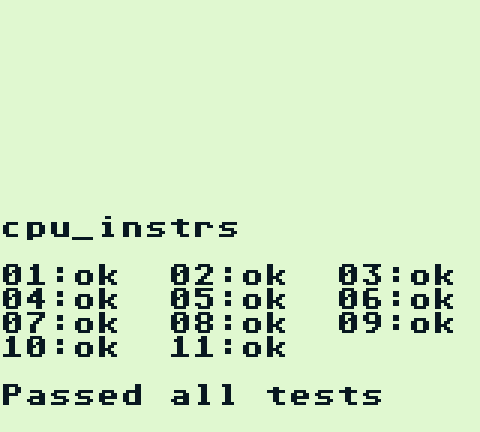
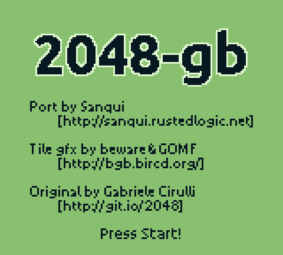
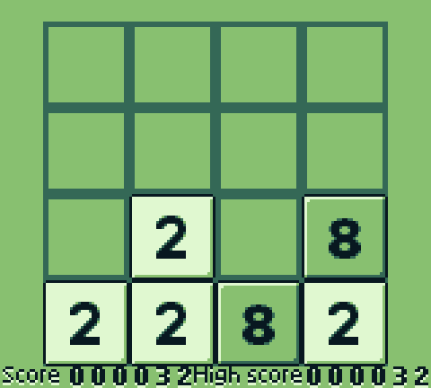
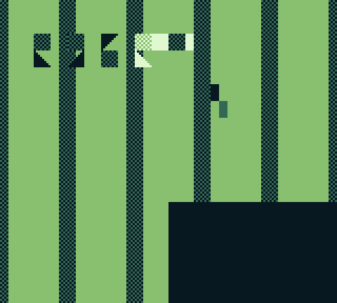

# A Game Boy in Kush

An emulator of the original Game Boy (DMG), written in Kush: the Sharp SM83
CPU with every instruction, the memory map, the timer, interrupts, OAM DMA, the
joypad, the serial port, the picture processor with background, window and
sprites, the four-channel sound chip, and the MBC1, MBC3 and MBC5 cartridge
controllers. It plays in a window with sound and gamepad support (through the
[media](../media/README.md) package, on SDL2), in a terminal, or headless for
testing.



## Results

- **Window, sound, gamepads**: tested on a virtual X display. The window's
  contents, read back from the display server, show the game at 4× with sharp
  pixels; key presses sent to the window drive the game; the sound, captured
  from SDL's output, is the game's music and effects; with a realistic audio
  device, 12 seconds of play produce exactly 12 seconds of sound at 60 fps.
  Gamepads are tested with a virtual SDL controller (see `../media`).
- **Blargg's `dmg_sound`**: 9 of 12 pass (registers, length counters, trigger,
  sweep, sweep details, overflow on trigger, length/sweep period sync, length
  counter during power, registers after power). The three failures read or
  write wave RAM while the wave channel plays, which depends on the exact
  cycle the channel reads it.

- **A real game**: Sanqui's open-source [2048-gb](https://github.com/Sanqui/2048-gb)
  (zlib licence; the ROM is in the [Homebrew Hub database](https://github.com/gbdev/database/tree/master/entries/2048gb))
  boots, shows its title screen, and plays in the terminal at a steady
  60 frames per second: arrow keys slide and merge the tiles, and the score
  and the cartridge-RAM high score update.

| Title screen (headless) | Playing, decoded from the terminal output |
| --- | --- |
|  |  |

- **Blargg's `cpu_instrs`**: all 11 parts pass, individually and as the
  combined MBC1 cartridge. **`instr_timing`** passes too, so every
  instruction takes the right number of cycles.
- **Speed**: the combined `cpu_instrs` run (227 million emulated clock cycles)
  takes 0.83 s in an LLVM build, about **65 times the real console's speed**,
  and 5 s in a Cranelift development build (11 times). The LLVM build compiles
  in 2.8 s, a development build in 0.5 s.
- **Graphics**: `tools/make_ppu_test.py` writes a ROM whose scene exercises
  scrolling, the window, 8×16 sprites, X and Y flips, both sprite palettes and
  the behind-background flag; the screenshot matches the hardware rules for
  each. The terminal front end's output, decoded back to pixels, matches the
  headless screenshot exactly.
- **Terminal**: a steady 60 frames per second; after the first frame, only
  changed cells are sent.



## Build and run

From this directory, with a current `kush`, Cargo and a C linker:

```sh
kush build --release --backend llvm      # or plain `kush build` for a fast build
./target/kush/gameboy game.gb             # play in a window, with sound
./target/kush/gameboy game.gb --terminal  # play in the terminal
./target/kush/gameboy test.gb 3000        # run 3000 frames headless; print serial output
./target/kush/gameboy test.gb 600 shot.ppm  # ...and save the last frame
kush test                                 # the emulator's own tests
```

Controls: arrows or WASD, X or K for A, Z or J for B, Enter for Start, Space
or Backspace for Select; Escape closes the window (Q quits in the terminal).
A gamepad is laid out like a Nintendo pad: the right face button is A, the
bottom one B, plus Start, Back (Select), the d-pad and the left stick.
Building needs SDL2 (`libsdl2-dev` or your distribution's package); without a
display the window falls back to the terminal, and without an audio device the
game runs silently, paced by the clock. With sound, the audio device's clock
paces the frames, so picture and sound never drift apart.

The terminal needs at least 160 columns by 73 rows with true colour. Where the terminal supports the kitty keyboard protocol
(kitty, WezTerm, foot, Ghostty, recent iTerm2), key releases are exact;
elsewhere a key counts as held for 180 ms after each press or autorepeat.

Test ROMs are not included. Blargg's are at
`https://github.com/retrio/gb-test-roms`; run, for example,
`./target/kush/gameboy cpu_instrs/cpu_instrs.gb 6000`.

## How it is built

| File | What it holds |
| --- | --- |
| `src/cartridge.kush` | The `Mapper` trait and one implementation per controller: `Plain`, `Mbc1`, `Mbc3`, `Mbc5`. |
| `src/machine.kush` | `Machine<M: Mapper>`: registers, memories, I/O registers; the bus, timer, DMA, joypad and serial port. |
| `src/cpu.kush` | The instruction set, decoded into the `Reg8`, `Pair`, `Alu`, `Cond` and `Shift` enums. |
| `src/ppu.kush` | Scanline timing, STAT interrupts and line rendering. |
| `src/apu.kush` | The sound chip: two square channels (one with sweep), wave, noise, frame sequencer, stereo mixing. |
| `src/desktop.kush` | The window front end, as handlers: picture, sound, keyboard and gamepads. |
| `src/emulator.kush` | The core's interface (`Buttons`, `Present`, `Play`), the frame loop and screenshots. |
| `src/terminal.kush` | The terminal front end, as handlers: renderer and frame pacing. |
| `terminal/` | A Rust adapter with no dependencies: raw mode and key events. |
| `tests/main.kush` | DAA, the stack, a timer interrupt waking HALT, MBC1 banking, frame length, a square wave and its length counter, and the core under a scripted test front end. |

Some choices that show the language:

- **Front ends are effect handlers.** The core is one loop,
  `emulator.run(m)`, that performs three declared operations per frame:

  ```kush
  pub effect Buttons: Unit -> i64 ! {io, alloc, panic};                // held buttons, -1 stops
  pub effect Present: Vec<u8> -> (Vec<u8>, Bool) ! {io, alloc, panic}; // a frame, lent and given back
  pub effect Play: Vec<i64> -> Vec<i64> ! {io, alloc, panic};          // the frame's sound, lent and given back
  ```

  The window, the terminal, the headless runner and a test are each a few
  handlers around that call; the core has no idea which one drives it.
  Handlers keep state by capturing references (`shown: &Window`,
  `pad: &mut Controls`) and counters, and the window installs `Play` outside
  its other handlers, once paced by the audio device and once by a clock, so
  the same session code runs with or without sound. The operation lists the
  effects its handlers may have, so `run`'s row says it can do I/O. Nothing
  is copied per frame: the core keeps a second screen and sample buffer,
  swaps the finished ones out with `m.screen.replace(spare)`, and the
  handlers give them back.
- **Memory accesses are proved in bounds.** The memories are
  length-refined fields (`vram: Vec<u8> where len >= 0x2000`), so a bus read
  after `if address < 0xA000 { .. }` is a plain load. Helpers state ranges
  with `ensures` (`fn wide(value: u8) -> i64 ensures { result == value }`)
  and erased parameters (`tile_pixel(m, at, column, erased inside: { 0 <= at
  && at < 0x1FFF })`). `KUSH_PROOF_REPORT=verbose kush check` lists what is
  left: 118 accesses are proved, every memory-bus read and write and every
  per-pixel access; the I/O registers keep their checks. It took 3600 frames
  of a commercial game from 6.6 s to 4.9 s with Cranelift (LLVM, which
  already hoisted most checks, stays at about 1.2 s).
- **The window and the audio device are linear.** `window.open` returns a
  `Window` that every path must pass to `window.close`; forgetting one is a
  compile error.
- **The machine is generic over its cartridge.** `main` reads the header and
  calls `play` with the right controller; each controller gets its own
  specialized emulator, and the bus calls `m.cartridge.load(address)` with no
  dispatch at run time.
- **Intended wraparound is explicit.** Registers are `u8` and `u16`;
  `Int.wrapping_add(m.pc, 1)` says the program counter wraps, and any other
  overflow would be a bug that Kush stops on.
- **Opcodes decode into enums.** `ld r, r'` is written once over `Reg8`, which
  includes `Hl` for the byte at address HL.
- **Two-phase borrows.** `push(m, m.pc)` and `machine.write(m, hl(m), value)`
  read `m` in an argument while passing `m` exclusively.

## What it needed from the compiler

Writing it this way needed additions to Kush, made alongside it and
documented in [places](../../docs/places.md): module-level `const`, indexing
and index assignment on `Vec` fields through references, field assignment on
`let mut` records, method calls on fields and through references, two-phase
exclusive borrows in calls, records without size limits, fields inside owning
fields through references (`m.apu.powered`), and exclusive borrows of two
different owning fields at once (`apu.sequence(&mut m.apu, &mut m.io)`).

Then, to use what is particular to Kush: length-refined `Vec` fields and
stronger loop and branch facts for the prover
([places](../../docs/places.md#length-refined-fields)); effects declared on
operations, reusable capturing handlers for called functions
([effect handlers](../../docs/effect-handlers.md)); and closures that capture
references as scoped borrows ([functions](../../docs/functions.md)).

## Not yet

- No Game Boy Color, no serial link, no saved games (cartridge RAM lives as
  long as the process), and the MBC3 clock reads as stopped.
- The HALT bug and the exact timing of reads and writes inside an instruction
  are not modelled: an instruction's memory accesses happen at its start, and
  the picture processor draws each line whole when it finishes.
- Not checked against `dmg-acid2` yet: no built ROM could be fetched in the
  environment this was written in; it builds from source with RGBDS.
